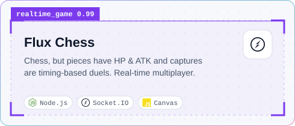
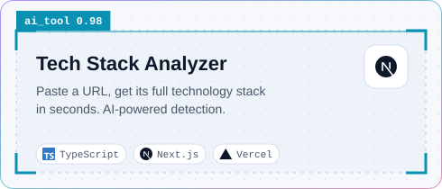
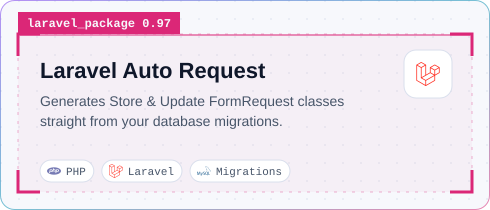
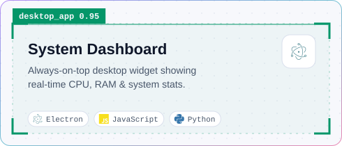

<div align="center">

<picture>
  <source media="(prefers-color-scheme: dark)" srcset="assets/hero-dark.svg">
  
</picture>

<a href="https://www.linkedin.com/in/abdullah-emin-esen-51694a209/"></a>


</div>

```python
class AbdullahEminEsen(Developer):
    building    = ["web apps with Laravel & Next.js", "AI-powered developer tools"]
    looking_for = "collaborators on AI-based projects"
    learning    = "cybersecurity"
    ask_me      = "YOLO (You Only Look Once) — the model, not the lifestyle"
    fun_fact    = "I play League of Legends 🤦🏽‍♂️"
```

<picture>
  <source media="(prefers-color-scheme: dark)" srcset="assets/stack-dark.svg">
  
</picture>

### `detections = model.predict("github.com/AbdullahEminEsen")`

<p>
  <a href="https://github.com/AbdullahEminEsen/Flux-Chess"><picture><source media="(prefers-color-scheme: dark)" srcset="assets/project-flux-chess-dark.svg"></picture></a>
  <a href="https://github.com/AbdullahEminEsen/techstack-analyzer"><picture><source media="(prefers-color-scheme: dark)" srcset="assets/project-techstack-analyzer-dark.svg"></picture></a>
  <a href="https://github.com/AbdullahEminEsen/laravel-auto-request"><picture><source media="(prefers-color-scheme: dark)" srcset="assets/project-laravel-auto-request-dark.svg"></picture></a>
  <a href="https://github.com/AbdullahEminEsen/system-dashboard"><picture><source media="(prefers-color-scheme: dark)" srcset="assets/project-system-dashboard-dark.svg"></picture></a>
</p>

<picture>
  <source media="(prefers-color-scheme: dark)" srcset="assets/metrics-dark.svg">
  
</picture>

<picture>
  <source media="(prefers-color-scheme: dark)" srcset="https://raw.githubusercontent.com/AbdullahEminEsen/AbdullahEminEsen/output/snake-dark.svg">
  
</picture>

<picture>
  <source media="(prefers-color-scheme: dark)" srcset="assets/footer-dark.svg">
  
</picture>
